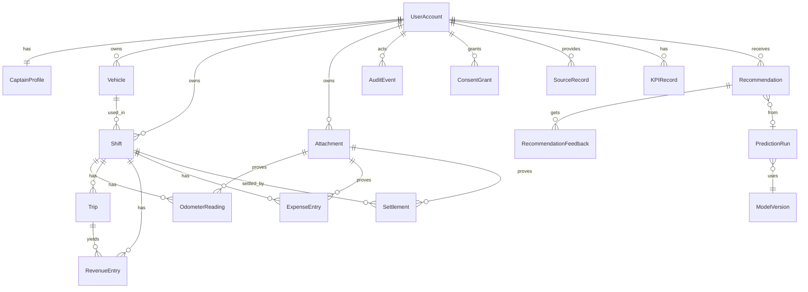

# ERD أولي — A0-14

- الحالة: PROPOSED — مسودة لا تعتمد قبل DEC-01/02/05/06/12/13
- الجلسة: 01
- مبادئ: الملكية تُستخرج من الجلسة لا من العميل · المبالغ أعداد صحيحة بالقرش مع `currency` · الحذف المنطقي للسجلات المالية · كل تصحيح يترك AuditEvent.

## قيود مقترحة
| الكيان | قيود |
|---|---|
| Shift | `owner_user_id` NOT NULL؛ `vehicle_id` ينتمي لنفس المالك؛ شيفت واحد OPEN لكل مالك (إن اعتمد DEC) ؛ `ended_at >= started_at`؛ التوقيت من الخادم |
| OdometerReading | `phase ∈ {start,end}` فريد لكل شيفت؛ `end >= start` |
| RevenueEntry/ExpenseEntry | `amount_minor >= 0`؛ `currency` إلزامي؛ `source` إلزامي؛ `idempotency_key` فريد لكل مالك |
| Settlement | `status ∈ {pending,confirmed,rejected}`؛ مسجلة ≠ مؤكدة |
| Attachment | تخزين خاص؛ `checksum`، `media_type`، `size` ؛ تنزيل بتفويض |
| AuditEvent | append-only |
| Recommendation | `valid_until`، `confidence`، `sample_size`، `model_version`، `source_refs` إلزامية |
| ConsentGrant | `purpose`، `scope`، `retention`، `granted_at`، `revoked_at` |

## نقاط مفتوحة
- المنطقة (Zone/H3) كعمود في Trip أم كيان؟ (DEC-10)
- تمثيل Correction: سجل تصحيح منفصل أم إصدارات؟ (DEC-06)
- ERD معتمد = شرط G1؛ هذا ليس ERD معتمدًا.
