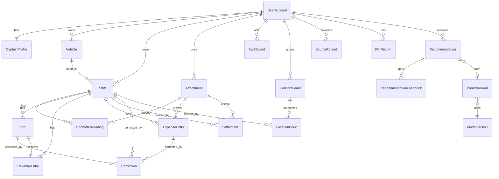

# ERD أولي — A0-14

- الحالة: PROPOSED — حُدّث في الجلسة 04 بقرارات DEC-01/02/04/06 (VERIFIED)؛ ما زال ينتظر DEC-03/05/12/13
- الجلسة: 01
- مبادئ: الملكية تُستخرج من الجلسة لا من العميل · المبالغ أعداد صحيحة بالقرش مع `currency` · الحذف المنطقي للسجلات المالية · كل تصحيح يترك AuditEvent.

## قيود مقترحة
| الكيان | قيود |
|---|---|
| Vehicle | **مركبة نشطة واحدة لكل مالك** (قيد فريد جزئي `WHERE status='active'`) — DEC-01 |
| Trip | إلزامي لكل إيراد (DEC-02)؛ `platform`، `occurred_at`، `fare_minor >= 0` كما سجّله الكابتن؛ لا حذف، إبطال منطقي فقط |
| LocationPoint | DEC-10: `shift_id` و`consent_id` NOT NULL؛ `lat/lon/accuracy_m/captured_at`؛ يُقبل فقط والشيفت OPEN وعقد ConsentGrant غير مسحوب؛ الاحتفاظ UNKNOWN |
| Correction | append-only: `entity_type`, `entity_id`, `field`, `old_value`, `new_value`, `reason` NOT NULL, `actor_user_id`, `created_at` — DEC-06 |
| Shift | `owner_user_id` NOT NULL؛ `vehicle_id` ينتمي لنفس المالك؛ شيفت واحد OPEN لكل مالك (PROPOSED)؛ `operating_date` = تاريخ البدء بتوقيت القاهرة (DEC-04)؛ `ended_at >= started_at`؛ التوقيت من الخادم |
| OdometerReading | `phase ∈ {start,end}` فريد لكل شيفت؛ `end >= start` |
| RevenueEntry/ExpenseEntry | `amount_minor >= 0`؛ `currency` إلزامي؛ `source` إلزامي؛ `idempotency_key` فريد لكل مالك |
| Settlement | `status ∈ {pending,confirmed,rejected}`؛ مسجلة ≠ مؤكدة |
| Attachment | تخزين خاص؛ `checksum`، `media_type`، `size` ؛ تنزيل بتفويض |
| AuditEvent | append-only |
| Recommendation | `valid_until`، `confidence`، `sample_size`، `model_version`، `source_refs` إلزامية |
| ConsentGrant | `purpose`، `scope`، `retention`، `granted_at`، `revoked_at` |

## نقاط مفتوحة
- المنطقة (Zone/H3): تُشتق من LocationPoint أو تُدخل يدويًا؟ — تُحسم مع ALG-11 (D2)
- ~~تمثيل Correction~~ حُسم: سجل `Correction` منفصل append-only (INFERRED من DEC-06، للمدير الاعتراض)
- ERD معتمد = شرط G1؛ هذا ليس ERD معتمدًا.
