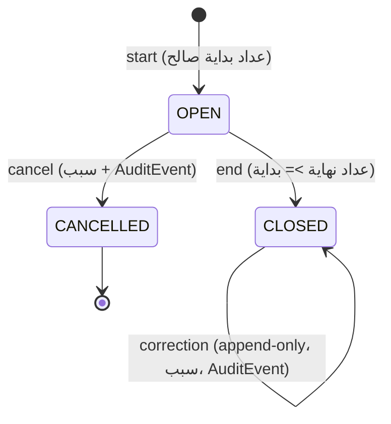
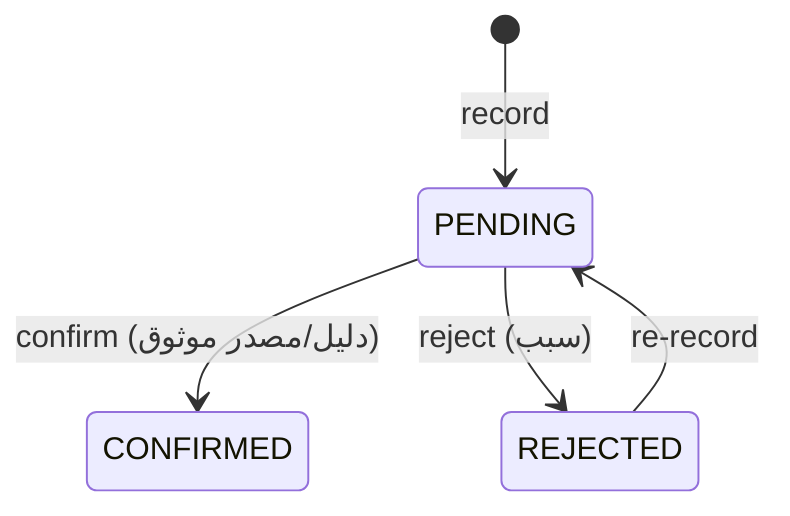

# State Machines — A1-02 (مسودة PROPOSED)

- DEC-06 (تصحيح append-only بلا حذف ولا إعادة فتح) وDEC-02 (رحلة برحلة): **VERIFIED**. ما زال يحتاج DEC-13 (التسوية).
- لا تتضمن أي قاعدة مالية.

## 1. الشيفت

| الانتقال | شرط | رفض |
|---|---|---|
| start | المركبة النشطة الوحيدة (DEC-01)؛ لا شيفت OPEN آخر (PROPOSED) | 409 |
| end | الحالة OPEN؛ end_odometer >= start | 409/422 |
| correction | CLOSED فقط؛ سبب إلزامي | 422 |
| أي انتقال من حالة طرفية | — | 409 |

## 2. التسوية (Settlement)

القاعدة: «مسجلة» لا تساوي «مؤكدة» (FR-013).

## 3. الرحلة (Trip) — DEC-02 VERIFIED
`RECORDED → VOIDED` فقط (إبطال منطقي بسبب)، بلا حذف. تُسجَّل الرحلة فقط والشيفت OPEN؛ ما بعد الإغلاق يتم عبر Correction (DEC-06).

## 4. التوصية (Recommendation) — D3
`ISSUED → ACCEPTED | DISMISSED | EXPIRED` (انتهاء `valid_until`). القرار النهائي للكابتن.

## اختبارات مرتبطة
T-SH-01..04، T-SET-01.
