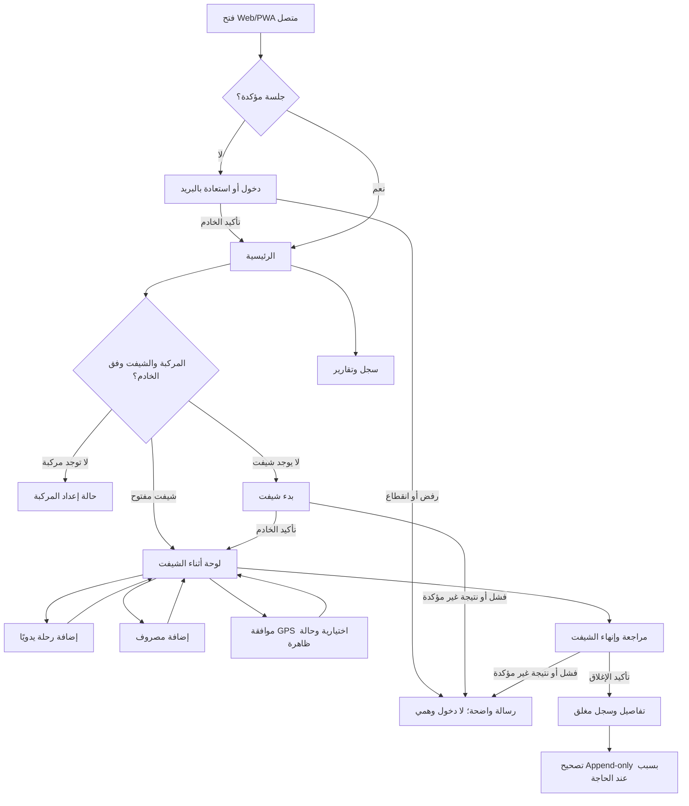

# مواصفة تنفيذ تجربة Web/PWA للكابتن — FC-004

- **Issue:** [#5 — FC-004، تكليف UX الأصلي لـCLAUDE-2](https://github.com/mosabosama2030-oss/Fleet-commander-/issues/5)
- **مالك التنفيذ الحالي:** MANUS-1 — إعادة تكليف لهذه المهمة بتوجيه MOSAAB؛ لا يعني ذلك اعتمادًا بصريًا أو تقنيًا.
- **الحالة:** PARTIAL — مواصفة UX قابلة للمراجعة؛ لا كود واجهة ولا اعتماد لـA0/G0/G1.
- **Base SHA:** `ee2a019c1eb604933d984ff9aee03c4f898fbcd6` (`main`، آخر SHA متحقق عند إنشاء الفرع).
- **مصدر المتطلبات غير المدمج:** `session/05-tech-auth-gps` عند `fd0805a579daad06922fe654173bdc30159d6b4f`.
- **الفروع ذات الصلة وقت بدء العمل:** PR #13 (تصميم Backend) وPR #18 (نواة Backend) غير مدمجين؛ لا يُعامل محتواهما كعقد معتمد. لا يغيّر هذا المستند ملفات تلك المهام.
- **النطاق:** متطلبات واجهة شاشة-بشاشة، حالات العرض والإرسال، اعتماديات API المفاهيمية، RTL والوصول والاستخدام الآمن، وسيناريوهات قبول.
- **خارج النطاق:** تنفيذ الواجهة، تصميم بصري نهائي أو Design Tokens، اختيار تقنية/مزود، تعريف API جديد، حسم قواعد مالية أو خصوصية مفتوحة، أو الادعاء باجتياز المستخدم الفعلي.

## 1. طريقة قراءة الأدلة

- **VERIFIED:** قرار موثق من Human Director في سجل DEC الأحدث على فرع الجلسة، أو ثابت في تعليمات المشروع.
- **INFERRED:** قيد منصة أو نتيجة مستنبطة لم تختبر على الأجهزة المستهدفة.
- **PROPOSED:** سلوك UX/حقل/اعتمادية مرشحة، لا تصبح قاعدة منتج قبل مراجعة المالك.
- **UNKNOWN:** لا توجد أدلة كافية لتحديد السلوك.
- أي مسار أو Schema مقتبس من مستندات `session/05-tech-auth-gps` موسوم **PROPOSED** ما لم يذكر صراحةً أنه قرار بشري VERIFIED. هذه المستندات لم تكن ضمن `main` عند Base SHA أعلاه.

## 2. ثوابت لا تعيد الواجهة فتحها

| الثابت | الدليل والحالة | أثره في UX |
|---|---|---|
| المستخدم Captain فردي؛ لا سوق مطابقة ولا إدارة أسطول | تعليمات المشروع — VERIFIED | المحتوى والعمليات تخص حساب الكابتن نفسه؛ لا تعرض واجهات مشرف أسطول. |
| Web + Android مستهدفان | A0 وFR-015 — VERIFIED للمنصات | تدفقا العمل الأساسيان متسقان، لكن هذا المستند يحدد Web/PWA؛ لا يدعي تنفيذ Android. |
| الاتصال Online-only، بلا Offline mode أو طابور مزامنة | تعليمات المشروع وA0 — VERIFIED | لا تعرض «تم الحفظ» اعتمادًا على التخزين المحلي، ولا ترسل إدخالًا تشغيليًا تلقائيًا بعد عودة الشبكة. |
| مركبة واحدة نشطة لكل كابتن | DEC-01 في سجل الجلسة 05 — VERIFIED | لا تعرض اختيارًا بين مركبات نشطة متعددة. تعامل مع غياب المركبة أو تعارضها كحالة خادم تحتاج معالجة/إعدادًا. |
| تسجيل الرحلات يدويًا رحلةً برحلة | DEC-02 — VERIFIED | لا تستورد الرحلات أو المبالغ تلقائيًا من تطبيقات النقل. |
| يوم الشيفت هو يوم بدايته بتوقيت القاهرة، بلا سعر/أجر مختلف لليل | DEC-04 — VERIFIED | اعرض التاريخ التشغيلي وفق يوم البدء؛ لا تنشئ خيار «ليل/نهار» أو أسئلة ساعات الليل. |
| التصحيح بعد الإغلاق Append-only بسبب وسجل تدقيق؛ لا حذف ولا إعادة فتح | DEC-06 — VERIFIED | شاشة التصحيح تضيف واقعة جديدة؛ تبقي الأصل ظاهرًا ولا تعرض تحريرًا صامتًا. |
| البريد وكلمة المرور، والاستعادة عبر البريد | DEC-07 — VERIFIED | لا تضف تسجيلًا اجتماعيًا أو OTP بوصفه تدفقًا أساسيًا. |
| PWA أولًا وAndroid لاحقًا كتغليف | DEC-08 — VERIFIED جزئيًا | لا تحدد هذه المواصفة إطارًا أو استضافة أو WebView نهائيًا. |
| GPS أثناء شيفت مفتوح بموافقة صريحة | DEC-10 — VERIFIED جزئيًا | لا يبدأ جمع الموقع افتراضيًا، وتظل حالة التتبع واضحة وقابلة للإيقاف. الاحتفاظ والعينات غير محسومة. |

## 3. قراءة المصادر وتسوية التعارض

1. `docs/a1/UX_FLOWS_AR.md` على فرع الجلسة يقترح الشاشات، زر رحلة جديدة، مؤشر GPS وسلوك إرسال موحد. حالته **PROPOSED**؛ يُستفاد منه كمدخل، لا كاعتماد لكل الحقول أو التفاصيل.
2. `docs/a0/USER_JOURNEY_AR.md` يعلن أن رحلة A0-03 مسودة وأنها تنتظر مراجعة الكابتن. الاستراحة، الرحلات المنسية، وتفاصيل الحقول فيه **PROPOSED/UNKNOWN**.
3. `docs/a1/OPENAPI_CORE_AR.yaml` يعرّف مسودة غير مالية لـlogin/profile/vehicles/consents/location/attachments/errors. في مقدمته يوضح أن عمليات shifts/revenue/expense/settlement خارج عقد Core الحالي. عنوان الخادم `example.invalid`، فلا يستخدمه العميل كخادم فعلي.
4. `docs/a1/STATE_MACHINES_AR.md`, `SECURITY_DESIGN_AR.md`, و`DATA_DICTIONARY_AR.md` على الفرع نفسه مسودات. تستعمل هنا لتحديد أسئلة التوافق، لا لإقرار حقول أو API.
5. تغييرات Backend في PR #18 ليست مدمجة. لا تفترض هذه المواصفة توافق واجهتها معها، ولا تطلب تغييرها؛ يلزم على مالك Backend مراجعة نقاط التوافق عند تثبيت عقد API.
6. المصدر `session/05-tech-auth-gps` وPR #13 غير مدمجين في Base. أي تعارض يُرفع للمراجعة ولا يحسمه هذا المستند.

## 4. خريطة التنقل المقترحة



الرسم **PROPOSED** لتدفق الواجهة. `X` حالة عامة وليست شاشة دائمة؛ لا يفترض الرسم وجود API أو شرط تداخل شيفت معتمد. فشل الشبكة لا ينشئ حالة عمل Offline.

## 5. قاموس الحالات المشتركة

### 5.1 حالة تحميل/حفظ العملية

| الحالة | العرض المطلوب | القيد |
|---|---|---|
| `IDLE` | الشاشة جاهزة؛ لا تحميل غير ضروري | لا تعرض بيانات على أنها حديثة إن كانت لم تُتحقق من الخادم. |
| `LOADING` | مؤشر تحميل مع عنوان/سياق مفهوم | امنع الإرسال المكرر أثناء الطلب؛ حافظ على تنقل واضح. |
| `SUBMITTING` | تسمية مثل «جارٍ الإرسال/الحفظ» وتعطيل الإجراء المكرر مؤقتًا | لا تغيّر الحالة المحلية إلى نجاح قبل رد تأكيد. |
| `CONFIRMED` | نجاح صريح بعد استجابة معتمدة، وحدّث مصدر البيانات | «نجاح» لا يعني أن مبلغًا محسوبًا أو مستلمًا إلا إذا أثبت العقد ذلك. |
| `VALIDATION_ERROR` | اربط الخطأ بالحقل ورسالة قابلة للتصرف | لا تعرض Stack trace أو رسالة خادم خام. |
| `AUTH_REQUIRED` | أبلغ انتهاء/غياب الجلسة، واطلب دخولًا جديدًا | لا تعرض بيانات الحساب بعد فقد الجلسة. |
| `ACCESS_UNAVAILABLE` | رسالة عامة لا تكشف وجود سجل غير مملوك | يجب أن يطبق الخادم الملكية؛ لا تعتمد الواجهة على إخفاء الأزرار كحماية. |
| `RETRYABLE_FAILURE` | وضّح أن الطلب لم يؤكد؛ أتح إعادة المحاولة فقط وفق قواعد التكرار المعتمدة | لا تضع كتابة تشغيلية في Queue ولا تعاود بصمت. |
| `OUTCOME_UNKNOWN` | «لم نتمكن من تأكيد نتيجة العملية»؛ اعرض وسيلة تحقق من السجل إن توفرت | عند timeout بعد إرسال كتابة، لا تفترض نجاحًا أو فشلًا ولا تُنشئ نية جديدة تلقائيًا. |
| `EMPTY` | حالة فارغة تشرح ما يمكن فعله تاليًا | لا تستخدم صفرًا يوحي بعملية حساب مؤكدة. |

هذه الحالات توصية **PROPOSED**. تعريف أكواد API وإعادة الإرسال وIdempotency مسئولية عقد API/Backend، لا واجهة منفردة.

### 5.2 حالة الشبكة

- `ONLINE`: الاتصال متاح حسب المتصفح؛ لا يساوي نجاح طلب بعينه.
- `REQUEST_IN_PROGRESS`: طلب ينتظر النتيجة؛ لا تُظهر نجاحًا مسبقًا.
- `REQUEST_FAILED`: الخادم/الشبكة لم يقدما تأكيدًا؛ اشرح أن البيانات الجديدة غير مؤكدة.
- `OUTCOME_UNKNOWN`: انقطع الرد بعد إرسال الطلب؛ استعلم عن الحالة إن كان العقد يوفر ذلك، وإلا اطلب مراجعة السجل قبل إعادة إرسال إدخال جديد.
- عند رجوع الاتصال لا تُرسل تلقائيًا أي كتابة قديمة؛ لا يوجد Offline mode وفق A0.

### 5.3 حالة GPS المعروضة

`NOT_REQUESTED`، `CONSENT_PENDING`، `DEVICE_PERMISSION_DENIED`، `ACTIVE_FOREGROUND`، `PAUSED_OR_UNAVAILABLE`، `CONSENT_REVOKED`، `SHIFT_CLOSED`. الأسماء مفاهيم UX **PROPOSED**؛ لا تُظهر `ACTIVE` إلا عندما يؤكد النظام/المنصة صلاحية الموافقة والإذن ويكون جمع الموقع قائمًا فعلًا. لا يكفي وجود مفتاح مفعّل في الواجهة لإثبات استقبال الخادم للنقاط.

## 6. مواصفة الشاشات

### UX-00 — غلاف التطبيق وحالة الجلسة

- **الغرض:** مدخل موحد لـWeb/PWA، يحدد الجلسة وحالة الاتصال قبل عرض عمليات Captain.
- **العناصر:** اسم المنتج؛ عنوان صفحة واضح؛ منطقة محتوى واحدة؛ مؤشر شبكة غير لوني فقط؛ مساحة رسائل حالة قابلة للوصول؛ زر تسجيل الخروج عند وجود جلسة مؤكدة.
- **الحالات:** فحص جلسة / غير مصادق / مصادق / خطأ تحقق جلسة / استجابة غير متاحة.
- **اعتمادية API:** قراءة حالة الجلسة وخروج المصادقة؛ مسارات مقترحة فقط في OpenAPI Core (`POST /auth/logout`). لا يعتمد عميل الويب URL الخادم الوهمي `example.invalid`.
- **قيد:** لا تعرض لوحة Captain عند جلسة منتهية أو غير معروفة على أنها صالحة. لا تعرض محتوى خاصًا أثناء فحص تفويض فاشل.

### UX-01 — تسجيل الدخول واستعادة كلمة المرور

- **الغرض:** دخول البريد/كلمة المرور أو بدء استعادة الحساب.
- **عناصر:** بريد/معرّف دخول، كلمة مرور، إظهار/إخفاء محلي اختياري، إرسال، رابط «نسيت كلمة المرور؟». في تأكيد إعادة التعيين: رمز/رابط آمن وكلمة مرور جديدة وفق سياسة مستقبلية.
- **الحقول:** البريد وكلمة المرور **VERIFIED**؛ قواعد الصيغة/الحدود **UNKNOWN** إلا ما يحدده مزود المصادقة بعد اختياره.
- **الحالات:** فارغ، تحقق إدخال، إرسال، نجاح دخول بعد تأكيد الخادم، خطأ دخول عام، انقطاع/timeout، rate limit، رسالة طلب استعادة عامة، رابط استعادة منتهي/غير صالح.
- **اعتمادية API:** مسارات Core المقترحة `POST /auth/login`, `POST /auth/password-reset/request`, `POST /auth/password-reset/confirm`. لا تكشف رسالة الاستعادة وجود البريد؛ بيانات كلمة المرور لا تدخل السجل/التحليلات ولا تحفظ في التخزين المحلي.
- **سلوك:** بعد `401` أو فشل اتصال لا تنقل المستخدم للرئيسية. عند طلب الاستعادة اعرض رسالة موحدة بغض النظر عن وجود الحساب.

### UX-02 — الرئيسية وحالة الشيفت

- **الغرض:** تلخيص حالة Captain الحية وتوجيهه لبدء الشيفت أو مواصلته.
- **العناصر:** بطاقة الشيفت الحالي إن أكده الخادم؛ زر بدء الشيفت عند عدم وجوده وفق استجابة موثوقة؛ المركبة النشطة إن توفرت؛ روابط السجل والإعدادات؛ حالة اتصال واضحة.
- **الحالات:** تحميل بيانات الحساب؛ مركبة غير مسجلة؛ لا شيفت؛ شيفت مفتوح؛ خطأ/انقطاع؛ حالة شيفت غير محسومة بعد timeout.
- **اعتمادية API:** ملف Captain/المركبة (`GET /me`, `GET /vehicles` مقترحة في Core) وقراءة حالة الشيفت الحالية. **لا يوجد في OpenAPI Core الذي تمت مراجعته مسار معتمد لجلب الشيفت الحالي.**
- **قيد:** لا تفسر غياب البيانات بسبب فشل الطلب على أنه «لا يوجد شيفت». لا تعرض مجاميع صافي.

### UX-03 — تجهيز المركبة وبدء شيفت

- **الغرض:** تلبية شرط المركبة النشطة ثم بدء الشيفت بتأكيد الخادم.
- **العناصر:** ملخص المركبة النشطة (DEC-01: واحدة فقط)؛ إن لم توجد، حالة إرشادية لإضافة/استعادة مركبة؛ زر بدء؛ حقول عداد البداية/الصورة تظهر كحقول **مرشحة** فقط إن وافق عليها المالك.
- **الحالات:** لا مركبة/إعداد مطلوب؛ بدء جاهز؛ إرسال؛ بدء مؤكد؛ تحقق خادمي فاشل؛ تعارض `409` محتمل فقط إذا اعتمده العقد؛ نتيجة غير مؤكدة.
- **اعتمادية API:** إنشاء/قراءة المركبة موجود كتصور في Core المقترح؛ عملية بدء الشيفت وحقولها ليست ضمنه. لا تفترض أن العداد أو الصورة إلزاميان: DEC-12 وحقل البداية ما زالا بحاجة إلى اعتماد.
- **سلوك:** لا تُظهر «الشيفت بدأ» قبل تأكيد الخادم. لا تسمح للواجهة باختراع وقت محلي بوصفه وقت بداية رسميًا. قواعد تعدد الشيفتات أو رفضه تظل **UNKNOWN**.

### UX-04 — لوحة أثناء الشيفت

- **الغرض:** شاشة عمل مختصرة تُستخدم عند توقف المركبة في مكان آمن؛ تعرض حالة الشيفت وتوفر إدخالًا يدويًا موجزًا.
- **العناصر:** شارة OPEN بعد تحقق الخادم؛ الوقت/يوم التشغيل المعتمد؛ زر رحلة جديدة وزر مصروف؛ زر إنهاء؛ شارة GPS إذا فُعّلت؛ شبكة/حفظ.
- **الحالات:** شيفت مفتوح مؤكد؛ تحميل سجل الفترة؛ فشل الاتصال؛ لا يمكن تأكيد حالة الشيفت؛ GPS غير مفعّل/مرفوض/فعّال أماميًا؛ إرسال كتابة.
- **اعتمادية API:** قراءة تفاصيل الشيفت والرحلات والمصروفات تحتاج عقدًا يحدد الملكية والتصفح والتحديث. `owner_user_id` لا يرسله العميل؛ يعتمد الخادم على الجلسة.
- **أمان/سلامة:** لا تعرض زرًا صغيرًا متكررًا أو إدخالًا طويلًا يتطلب تفاعلًا أثناء القيادة. النص الافتراضي يوجه المستخدم لإدخال البيانات عند التوقف. لا نقترح استشعار الحركة أو قفلًا تلقائيًا دون قرار واختبار مستقل.

### UX-05 — إضافة رحلة يدويًا

- **الغرض:** تسجيل رحلة واحدة يدويًا أثناء شيفت OPEN.
- **الحقول:** `amount`, `occurred_at`, `source/platform`, `note` أمثلة حقول **مرشحة** من المصادر؛ الإلزامية والقائمة والعملة والتقريب **UNKNOWN**. لا تعتمد الواجهة قائمة Uber/DiDi/inDrive النهائية قبل موافقة الكابتن/المنتج.
- **الحالات:** نموذج فارغ؛ تحقق حقل؛ إرسال؛ حفظ مؤكد؛ رفض/قيمة غير صالحة؛ timeout/نتيجة غير مؤكدة؛ الشيفت لم يعد OPEN.
- **اعتمادية API:** حاجة مفاهيمية إلى «إنشاء رحلة مرتبطة بالشيفت المفتوح». لا يوجد مسار رحلة معتمد في OpenAPI Core. لا تستورد أو تستخرج بيانات من تطبيق نقل.
- **عرض القيمة:** «إيراد/قيمة مسجلة كما أدخلها الكابتن» لا «صافي ربح» أو «مستلم»؛ لا تحسب أي مكافأة/أجر قبل DEC-03/05/09.
- **إعادة المحاولة:** تثبيت مفتاح idempotency لكل نية إرسال اقتراح في UX_FLOWS وOpenAPI لبعض العمليات فقط؛ يجب مواءمة عقد الرحلة قبل ضمان هذا السلوك. لا تنشئ طلبًا جديدًا آليًا عند timeout.

### UX-06 — إضافة مصروف

- **الغرض:** إدخال مصروف مرتبط بشيفت مفتوح وفق سياسة تعتمد لاحقًا.
- **الحقول:** القيمة والتصنيف ووقت الوقوع مرشحة؛ التصنيفات، العملة، السماح بصفر/سالب، الملاحظة، الإيصال والإلزامية **UNKNOWN** حتى قرار DEC-05/09/12.
- **الحالات:** فارغ؛ تصنيف مطلوب إذا أصبح معتمدًا؛ تحقق؛ جارٍ الإرسال؛ حفظ مؤكد؛ مرفوض/انقطاع/نتيجة غير مؤكدة؛ انتهاء الشيفت.
- **اعتمادية API:** إنشاء المصروف/استرجاعه وتفويض الملكية غير معرفين في OpenAPI Core. لا تخترع endpoint أو تصنيفًا نهائيًا.
- **قيد مالي:** اعرض المصروف المسجل كما أدخل، ولا تخصمه من دخل/صافي في الشاشة ما لم يعتمد DEC-03/05/09.

### UX-07 — موافقة GPS ومؤشر التتبع

- **الغرض:** طلب موافقة صريحة على موقع الشيفت وتمكين الإيقاف الواضح.
- **قبل الموافقة:** شرح غرض الجمع بأنه أثناء الشيفت فقط، وما هو معلوم وما يزال غير معلوم؛ زران متساويا الوضوح «أوافق» و«لا أوافق»؛ استمرار الوظائف الأساسية دون موقع عند الرفض.
- **بعد الموافقة:** اطلب إذن المنصة في السياق المناسب؛ اعرض مؤشر حالة واضحًا طوال الشيفت، لا باللون وحده؛ وفر «إيقاف الموقع/سحب الموافقة» دائمًا.
- **الحالات:** غير مطلوب؛ طلب موافقة؛ مرفوض من المستخدم؛ إذن متصفح مرفوض؛ فعال في المقدمة؛ غير متاح/التطبيق بالخلفية؛ موافقة مسحوبة؛ الشيفت مغلق.
- **اعتمادية API:** `/consents` و`/consents/{id}` و`/shifts/{id}/locations` واردة في OpenAPI Core **المقترح**. المستند يقترح أن السحب يوقف قبول نقاط جديدة؛ retention/deletion للنقاط السابقة **UNKNOWN**. عدم وجود إذن أو شيفت OPEN يجب أن يمنع الجمع.
- **قيد منصة INFERRED:** PWA لا يضمن التتبع والشاشة مقفلة/التطبيق بالخلفية. لا تضع شارة «يتتبع الآن» لمجرد أن الموافقة سابقة؛ عند عودة الصفحة أعد فحص الحالة الفعلية. لا تعد بتتبع مستمر موثوق.
- **خصوصية:** لا ترسل الموقع إلى طرف ثالث أو خرائط؛ التكامل غير معتمد. لا تعد المستخدم بحذف/احتفاظ محدد قبل DEC-10.

### UX-08 — مراجعة وإنهاء الشيفت

- **الغرض:** مراجعة القيم المسجلة قبل طلب الإغلاق.
- **العناصر:** قائمة السجلات كما أكدها الخادم؛ وقت الشيفت واليوم التشغيلي؛ حقول عداد النهاية أو تنبيه النواقص فقط إذا اعتمدت؛ زر تأكيد الإنهاء مع مراجعة نهائية قابلة للفهم.
- **الحالات:** تحميل؛ جاهز؛ إرسال؛ إغلاق مؤكد؛ تحقق مرفوض؛ انقطاع أو نتيجة غير مؤكدة؛ الشيفت أُغلق من جلسة أخرى.
- **اعتمادية API:** عملية إنهاء الشيفت، قراءة البيانات اللازمة، وكشف نتيجة timeout غير محددة في OpenAPI Core. لا تفترض حقولًا أو `PATCH` بعينه.
- **سلوك:** لا تظهر إغلاقًا ناجحًا قبل تأكيد الخادم. لا تحسب صافيًا/مستحقًا حتى إغلاق DEC-03/05/09. لا تغلق تلقائيًا عند مغادرة الصفحة أو منتصف الليل.

### UX-09 — الشيفت المغلق والتصحيح

- **الغرض:** عرض سجل محفوظ وقابل للتدقيق؛ تقديم تصحيح جديد بدل تحرير الأصل.
- **العناصر:** تمييز الأصلي عن التصحيحات وتوقيتها وسببها؛ زر تصحيح مشروط بسياسة التطبيق؛ سبب واضح مطلوب وفق DEC-06.
- **الحالات:** مغلق مؤكد؛ لا صلاحية؛ تصحيح جديد جارٍ/مؤكد/مرفوض؛ لا اتصال/نتيجة غير مؤكدة.
- **اعتمادية API:** قراءة السجل وعملية correction append-only غير موصوفتين في Core؛ يجب أن يقرر Backend حقول الحدث وقواعد إعادة احتساب التقرير. لا حذف ولا إعادة فتح من الواجهة.
- **عرض مالي:** لا توحّد القيم المتعارضة في صافي غير معتمد؛ بيّن أن هناك تصحيحًا وأثره على التقرير ما يزال يتبع قواعد معلقة.

### UX-10 — سجل الشيفتات والتقرير

- **الغرض:** استعراض سجلات الكابتن وفترة زمنية منطقية دون الإيحاء بدقة حساب لم تعتمد.
- **العناصر:** مرشح فترة؛ قائمة/تفاصيل؛ صفحة فارغة؛ تحميل؛ إعادة المحاولة؛ عرض يوم الشيفت وفق يوم البدء بتوقيت القاهرة؛ وسم «مسجل» مقابل «محسوب/مقدر» عند الاقتضاء.
- **الحالات:** لا سجلات؛ نتائج؛ فترة غير صالحة؛ صلاحية منتهية؛ لا اتصال؛ تقرير غير مكتمل/حساب محجوب.
- **اعتمادية API:** استعلام سجل الشيفتات والتقرير/التجميع حسب الفترة غير موجود في OpenAPI Core. يجب تحديد التصفح والمنطقة الزمنية والحدود وملكية البيانات في عقد معتمد.
- **خصوصية:** كل استعلام من حساب الكابتن فقط. إخفاء السجلات الأخرى على الخادم إلزامي؛ لا تعتمد الفلاتر المحلية لعزل بيانات الغير.

### UX-11 — الملف والإعدادات والتصدير (تابعة وليست بوابة أساسية)

- **الغرض:** الملف والمنطقة الزمنية وإدارة الموافقات؛ التصدير لا يظهر إلا بعد اعتماد سياسة الوصول.
- **الحقول:** الاسم المعروض والمنطقة الزمنية موجودان كتصور في Core المقترح؛ تحرير الملف، إعدادات اللغة/المنطقة، إدارة الأجهزة، التصدير والحذف ليست جميعها محسومة.
- **الحالات:** تحميل، خطأ، تحديث مؤكد، رفض حقل، لا اتصال.
- **اعتمادية API:** `GET/PATCH /me` وقراءة الموافقات مقترحة في مصدر الجلسة؛ لا تفترض export endpoint أو تنزيلًا عامًا.

## 7. مصفوفة الاعتماديات المفاهيمية للـAPI

هذه **اعتماديات منتج** وليست تعريفًا أو تعديلًا لعقد API. المسارات بين backticks موجودة فقط في OpenAPI Core المقترح على `session/05-tech-auth-gps`؛ لا تستهدف واجهة فعلية قبل اعتماد الخادم والعقد.

| شاشة/عملية | حاجة الواجهة إلى الخادم | مرجع المسودة / ما ينقص | حالة الواجهة عند الفشل |
|---|---|---|---|
| الدخول/الخروج | تحقق كلمة المرور والجلسة وإبطالها | `POST /auth/login`, `POST /auth/logout` — مقترح؛ سياسة session/cookie/token تحتاج اختيارًا | لا انتقال قبل التأكيد؛ رسالة عامة؛ إعادة الدخول عند انتهاء الجلسة. |
| استعادة الحساب | بدء الاستعادة وتأكيدها دون كشف وجود الحساب | `POST /auth/password-reset/request`, `/confirm` — مقترح | رسالة قبول عامة؛ لا تعرض ما إذا كان البريد موجودًا. |
| الملف/المركبة | قراءة الملف والمركبة المملوكة وإضافة مركبة عند غيابها | `GET/PATCH /me`, `GET/POST /vehicles` — مقترح؛ تفاصيل إدارة المركبة وملكية المرفقات تحتاج اعتمادًا | لا تفترض «فارغ» عند فشل القراءة؛ لا تعرض موردًا غير مملوك. |
| حالة الشيفت/البدء/الإغلاق | قراءة الحالة وإنشاء الشيفت وإغلاقه | لا يوجد مسار نهائي في OpenAPI Core؛ contract + الحقول وقاعدة التداخل مطلوبة | لا نجاح مسبق؛ نتيجة غير مؤكدة عند timeout؛ لا إنشاء/إغلاق تلقائي. |
| الرحلات | إنشاء/قراءة/تصفح سجل رحلة يدوي | لا يوجد route/schema نهائي؛ الحقول والتكرار وDEC-03/09 مطلوبة | لا وعد بالحفظ؛ مراجعة السجل قبل نية جديدة بعد timeout. |
| المصروفات | إنشاء/قراءة وتعديل مسموح قبل الإغلاق إن اعتمد | لا يوجد route/schema نهائي؛ DEC-05/09 وحقول الإيصال مطلوبة | رسالة تحقق/فشل؛ لا صافي مالي. |
| GPS | قراءة الموافقة، منحها/سحبها، والتحقق من قبول نقطة الموقع | `/consents`, `/consents/{id}`, `/shifts/{id}/locations` — مقترح؛ intervals/retention غير محددة | إيقاف/عدم بدء الجمع عند غياب الموافقة؛ لا تدّع حالة فعالة عند فقد الإذن/الخلفية. |
| تصحيح | إنشاء event append-only وتأكيد سبب/actor | لا يوجد route/schema نهائي؛ DEC-06 يثبت المبدأ فقط | لا تحرير صامت ولا حذف؛ نتيجة غير مؤكدة تحتاج تحققًا. |
| سجل/تقارير | قراءة سجلات فترة مصرح بها وإرجاع مصدر كل قيمة | لا يوجد route/schema نهائي للتقرير أو الحساب | empty/error منفصلان؛ إظهار «الحساب المالي غير متاح» عند غياب القواعد. |
| مرفقات | رفع خاص، فحص نوع/حجم، تنزيل بتفويض | `/attachments` و`/attachments/{id}/content` — مقترح؛ MIME/الحجم من DEC-12 غير معتمد | فشل واضح؛ لا تعرض رابط تنزيل عام. |

**حدود العقد:** المصدر Core نفسه يقول إن العنوان الحالي `example.invalid` وأن الـhosting UNKNOWN. مفاتيح idempotency موجودة في تعريف المسودة لبعض العمليات، لكن ذلك لا يمنح UX حق افتراض دعمها لكل عمليات shifts/trips/expenses. يجب على مالك Backend تحديد سلوك الطلب/الرد وإعادة المحاولة قبل التطوير.

## 8. قواعد RTL وإمكانية الوصول والتفاعل الآمن

### 8.1 RTL والعربية

- `lang="ar"` واتجاه RTL على الغلاف؛ ترتيب التنقل والعناوين والنماذج منطقي من اليمين لليسار.
- عيّن `dir="ltr"` لمعرفات البريد/التوكنات/الأكواد والمراجع التقنية المختلطة فقط، مع إبقاء التسمية عربية.
- لا تعتمد اللون وحده لحالة التتبع أو الشبكة أو الخطأ؛ أضف نصًا ورمزًا/شكلًا مفهومًا.
- راجع التفاف النص، رسائل الأخطاء، الأرقام والتواريخ، أسماء التطبيقات الأجنبية، الحقول على عرض الهاتف، ولوحة المفاتيح الافتراضية.
- المنطقة الزمنية `Africa/Cairo` مثبتة ليوم التشغيل في DEC-04؛ لا تحوّلها إلى قرار منطقة افتراضية لعرض كل الملف دون سند.

### 8.2 الوصول والتشغيل بلوحة المفاتيح

- لكل حقل تسمية برمجية ظاهرة أو مكافئة؛ اربط الخطأ بالحقل واقرأ حالته لقارئات الشاشة.
- ترتيب Tab يطابق تدفقًا بصريًا مفهومًا؛ مؤشر التركيز واضح؛ الحوار يحافظ على التركيز ويعيده إلى موضعه عند الإغلاق.
- دعم تكبير النص/الصفحة وإعادة التدفق على شاشة ضيقة دون فقد إجراء أساسي.
- استخدم عناوين بنيوية، أسماء أزرار ذات معنى («إنهاء الشيفت» بدل «موافق»)، وحالة تحميل/حفظ قابلة للإعلان دون إعلان متكرر مزعج.
- **PROPOSED:** يراجع فريق التصميم/QA مستوى التباين وحجم أهداف اللمس مقابل معيار وصول يختاره المشروع قبل الاعتماد؛ هذه المواصفة لا تدعي مطابقة WCAG أو اجتياز اختبار وصول.

### 8.3 السلامة أثناء القيادة

- النص والمحتوى يشجعان صراحةً على إدخال الرحلات/المصروفات والتفاعل مع الهاتف بعد التوقف في مكان آمن؛ لا يطلب التطبيق تفاعلًا أثناء حركة المركبة.
- أثناء الشيفت، فضّل إجراءات قليلة واضحة وأزرارًا كبيرة نسبيًا، لكن لا تعتبر ذلك وحده ضمان سلامة أو تصريحًا للتفاعل أثناء القيادة.
- لا تستخدم تنبيهًا يحتاج ردًا فوريًا أو نافذة modal تحجب الحالة الأساسية عند العودة؛ وفّر تأجيلًا آمنًا للمدخلات غير الضرورية.
- **UNKNOWN:** لا يوجد دليل على مستشعر/إشارة حركة معتمدة أو سياسة «قفل القيادة». لا تختلق اكتشاف سرعة أو تعطيل واجهة تلقائيًا؛ أي سلوك كهذا يحتاج قرارًا واختبار سلامة منفصلين.
- لا تعتمد على إشعارات خلفية أو GPS مستمر في PWA. توضح الواجهة حد foreground وتعرض الحالة الفعلية المتاحة.

## 9. سيناريوهات القبول المقترحة

هذه معايير تحقق للمواصفة والتنفيذ اللاحق، وليست دليلًا على اختبار منتج. الحقول المالية والسلوكيات المتوقفة على القرارات لا تصبح قابلة للقبول حتى يعتمدها MOSAAB.

### UX-AC-01 — الدخول لا يسبق تأكيد الخادم

```gherkin
Given أن الكابتن على Web/PWA ولديه اتصال
When يرسل البريد وكلمة المرور
Then لا تظهر لوحة الحساب قبل تأكيد جلسة صالحة
And لا تسجل الواجهة كلمة المرور في URL أو السجلات
```

### UX-AC-02 — استعادة لا تكشف وجود الحساب

```gherkin
Given أن الكابتن يطلب استعادة عبر البريد
When يقبل الخادم الطلب أو يرفضه لأسباب لا يجوز كشفها
Then تعرض الواجهة رسالة عامة لا تكشف وجود الحساب
And لا تعلن اكتمال تغيير كلمة المرور قبل تأكيده
```

### UX-AC-03 — الحالة الفارغة تختلف عن فشل القراءة

```gherkin
Given أن الصفحة تطلب المركبة أو الشيفت من الخادم
When يرجع الخادم نتيجة فارغة مؤكدة
Then تعرض الواجهة حالة «لا توجد بيانات» المناسبة
When يفشل الطلب أو تنتهي الجلسة
Then لا تفسر ذلك على أنه لا مركبة أو لا شيفت
```

### UX-AC-04 — عدم نجاح وهمي للشيفت

```gherkin
Given أن الكابتن يطلب بدء شيفت
When ينقطع الاتصال أو لا يصل رد تأكيد
Then لا تعرض الواجهة شيفتًا مفتوحًا محفوظًا
And لا تعيد إنشاء الطلب تلقائيًا عند عودة الاتصال
And تعرض نتيجة غير مؤكدة وخطوة تحقق آمنة
```

### UX-AC-05 — تسجيل يدوي بلا استيراد

```gherkin
Given أن شيفتًا مفتوحًا ومؤكدًا
When يضيف الكابتن رحلة
Then تكون البيانات مدخلة يدويًا
And لا تستورد الواجهة بيانات من تطبيق نقل
And لا تعرض صافيًا نهائيًا قبل اعتماد DEC-03/05/09
```

### UX-AC-06 — حقول unresolved لا تصبح إلزامية

```gherkin
Given أن سياسة حقول الرحلة أو المصروف لم تعتمد بعد
When تعرض الواجهة النموذج أو فريق التنفيذ يبني التحقق
Then تظل الحقول المرشحة مميزة عن المعتمدة
And لا تفرض الواجهة تصنيفًا أو عملة أو صورة أو قيمة افتراضية من هذا المستند وحده
```

### UX-AC-07 — تكرار آمن ونتيجة timeout

```gherkin
Given أن كتابة وصلت إلى الخادم لكن الرد لم يصل للواجهة
When تنتهي مهلة الانتظار
Then تعرض الواجهة «لم نتأكد من النتيجة» لا «فشل» ولا «نجاح»
And لا ترسل نية جديدة صامتة
And لا تستخدم إعادة المحاولة بمفتاح جديد قبل أن يحدد عقد API السلوك
```

### UX-AC-08 — لا عمل Offline

```gherkin
Given أن الكابتن فقد الاتصال أثناء الشيفت
When يحاول حفظ رحلة أو مصروف أو إنهاء الشيفت
Then تظهر حالة فشل/نتيجة غير مؤكدة حسب ما أمكن إرساله
And لا تعرض العملية كأنها محفوظة خادميًا
And لا تخزن طابورًا يرسل تلقائيًا لاحقًا
```

### UX-AC-09 — تصحيح لا يمحو الأصل

```gherkin
Given أن شيفتًا مغلقًا
When يطلب الكابتن تصحيحًا ويقدم السبب بعد اعتماد التدفق
Then ينشأ إدخال تصحيح مستقل مع أثر تدقيق
And يبقى الأصل قابلًا للعرض
And لا يوجد زر حذف للأصل أو إعادة فتح للشيفت
```

### UX-AC-10 — موافقة ومؤشر GPS

```gherkin
Given أن شيفتًا مفتوحًا والكابتن لم يوافق صراحة
When يفتح شاشة العمل
Then لا يبدأ جمع الموقع وتظل الوظائف غير المعتمدة على GPS متاحة
When يوافق ثم يرفض المتصفح الإذن أو يسحبه
Then تعكس الواجهة حالة غير فعالة وتوقف بدء جمع جديد
And لا تعرض تتبعًا فعالًا دون حالة منصة فعلية
```

### UX-AC-11 — قيد PWA بالخلفية

```gherkin
Given أن التتبع يعمل في مقدمة PWA
When تُغلق الصفحة أو تصبح بالخلفية/الشاشة مقفلة
Then لا تدعي الواجهة استمرارية لم تثبتها المنصة
And عند الرجوع تعرض الحالة الفعلية بعد إعادة التحقق
```

### UX-AC-12 — البيانات والتقارير خاصة بالحساب

```gherkin
Given أن الكابتن يطلب سجلًا أو تقريرًا لفترة
When يستجيب الخادم
Then تعرض الواجهة بيانات الحساب المصادق عليه فقط
And تميز القيمة المدخلة عن المحسوبة أو المقدرة
And تنسب الشيفت ليوم بدايته بتوقيت القاهرة
And لا تعرض صافيًا ماليًا غير معتمد
```

### UX-AC-13 — تصحيح RTL وإتاحة أساسية

```gherkin
Given أن المتصفح باللغة العربية وعلى عرض هاتف أو سطح مكتب
When يتنقل المستخدم بلوحة المفاتيح ويملأ حقلًا خاطئًا
Then يبقى ترتيب القراءة والتركيز منطقيًا من RTL
And يصل اسم الحقل والخطأ والحالة لقارئ الشاشة
And لا يكون اللون الوسيلة الوحيدة لفهم النجاح/الخطأ/GPS
```

### UX-AC-14 — الاستخدام الآمن

```gherkin
Given أن الكابتن في شيفت عمل
When تعرض الواجهة إجراءً يتطلب كتابة أو تأكيدًا طويلًا
Then توجهه الواجهة لإكماله بعد التوقف في مكان آمن
And لا تدعي أن التصميم أو GPS يضمنان سلامة التفاعل أثناء القيادة
And لا تفترض استشعار حركة المركبة أو قفل القيادة دون اعتماد
```

## 10. سجل القرارات المطلوبة قبل التطوير

| القرار/الاعتماد | ما المطلوب | أثره على UX | الحالة |
|---|---|---|---|
| DEC-03 وDEC-05 وDEC-09 | أمثلة دخل حقيقية منزوعة الهوية، التصنيفات، العملة والتقريب | حقول المبلغ/العرض/الإجماليات | UNKNOWN/BLOCKED؛ لا حساب مالي في المواصفة. |
| DEC-12 | إلزامية صورة العداد، أنواع الملفات، الحد الأقصى | تدفق رفع الإثبات والتحقق | PROPOSED فقط. |
| حقول بدء/إنهاء الشيفت | العداد، الصورة، الوقت، المصدر | UX-03 وUX-08 | UNKNOWN؛ لا فرض حقل. |
| الشيفت المفتوح/التداخل/الإلغاء | سياسة الشيفت المنسي والتداخل وما يظهر عند تضارب الحالة | الرئيسية والبدء/الإنهاء | UNKNOWN؛ لا إغلاق تلقائي. |
| DEC-10 | فترة العينات، الاحتفاظ، الأثر عند سحب الموافقة، الوصول/الحذف | شاشة الموافقة ومؤشر التتبع والإعدادات | VERIFIED جزئيًا فقط؛ موافقة صريحة. |
| DEC-08 | الخادم، الاستضافة، قاعدة البيانات، تغليف Android | Session/Cookies، Offline behavior، توافق المنصات | PWA-first/Android لاحقًا VERIFIED جزئيًا؛ التفاصيل UNKNOWN. |
| عقد API للكتابات | المسارات والحقول وأكواد الأخطاء والتصفح والـidempotency | جميع شاشات الإرسال | OpenAPI Core غير مدمج وغير شامل للشيفت/الرحلة/المصروف/التقرير؛ يحتاج مراجعة مالك Backend. |
| الوصول والسلامة | معيار وصول مستهدف واختبار عربي وجهاز فعلي وسياق القيادة | RTL، قارئات الشاشة، التفاعل | لم تختبر؛ يلزم مراجعة مستقلة قبل اعتماد القبول. |

## 11. خطة تحقق التنفيذ اللاحق

لا توجد واجهة ضمن هذا التغيير. عند بدء التنفيذ بعد G0/G1 واعتماد العقود، ينفذ مالك الواجهة خطة على الأقل:

1. **حالات الدفق:** login success/rejection/recovery؛ no vehicle؛ no/current shift؛ start/end confirm؛ validation؛ timeout after write؛ 401/403/404/409/422/429/5xx حيث ينص العقد.
2. **عدم التكرار/الشبكة:** افصل انقطاعًا قبل الإرسال عن timeout بعد وصول الكتابة؛ افحص عدم ظهور false success وعدم وجود retry تلقائي أو طابور offline.
3. **الخصوصية:** جرب GPS قبل/بعد الموافقة، الرفض والسحب، انتهاء الشيفت، فقد إذن المتصفح، والخلفية/قفل الشاشة على كل منصة مستهدفة. لا تعد بنتيجة قبل اختبارها.
4. **عزل البيانات:** اختبر حسابين بخادم الاختبار للتأكد أن الـAPI لا يعيد بيانات الغير؛ لا تعتبر اختفاء القائمة محليًا اختبار صلاحية.
5. **RTL/accessibility:** لوحة مفاتيح، قارئ شاشة، تكبير، ترتيب التركيز، رسائل الأخطاء، الأرقام والتواريخ المختلطة؛ عربية على هاتف وWeb responsive.
6. **سلامة الاستخدام:** مراجعة بشرية للتفاعل عند توقف المركبة، لا اختبار أثناء قيادة فعلية. لا تجمع بيانات حركة دون موافقة/قرار.
7. **Android:** لا اختبار تغليف/خلفية ضمن هذا المستند؛ يصبح مطلوبًا عند بدء قرار Android أو تسليم Claude-2/مالك UI بعد اعتماد التصميم.

## 12. المراجع التي فُحصت

- GitHub Issue #5 — FC-004: هدف ومجال ومعيار قبول المواصفة، مفتوحة عند المطالبة.
- `AGENTS.md`, `MANUS.md`, `docs/agents/TEAM_OPERATING_MODEL_AR.md`, `docs/agents/START_HERE_AR.md`, و`docs/agents/AGENT_TASK_INDEX_AR.md` على `main` عند `ee2a019c1eb604933d984ff9aee03c4f898fbcd6`.
- `session/05-tech-auth-gps` عند `fd0805a579daad06922fe654173bdc30159d6b4f`: `A0_REQUIREMENTS_AR.md`, `docs/a0/USER_JOURNEY_AR.md`, `docs/a0/OPEN_DECISION_REGISTER_AR.md`, `docs/a1/UX_FLOWS_AR.md`, `docs/a1/OPENAPI_CORE_AR.yaml`, `docs/a1/STATE_MACHINES_AR.md`, `docs/a1/SECURITY_DESIGN_AR.md`, `docs/a1/DATA_DICTIONARY_AR.md`, `docs/a1/ADR_INDEX_AR.md`, `docs/sessions/SESSION_05_REPORT_AR.md`.
- PR #13 وPR #18: فُحصت المسارات المفتوحة فقط لتجنب التعارض؛ ملفات Backend/ADR لا تدخل التغيير الحالي، وهي غير مدمجة.

## 13. حالة التنفيذ والحدود

- **تنفيذ المنتج:** NOT_REQUIRED لهذا التسليم؛ التغيير مواصفة وثائقية ولا ينفذ واجهة.
- **حالة المخرج:** PARTIAL — يحقق جزء التوثيق من FC-004؛ لا يصادق A0 ولا يطلق تنفيذ UI.
- **نتائج التحقق الفعلية:** فحوص Python بنيوية (الأقسام 1–13، الشاشات UX-00..11، السيناريوهات UX-AC-01..14، توازن أسوار الكود واتساق أعمدة الجداول) PASS؛ `manus-render-diagram /tmp/fc004-diagram.mmd /tmp/fc004-diagram.png` PASS، والمخطط روجع بصريًا؛ فحص HEAD لرابط Issue #5 أعاد HTTP 200. `git diff --cached --check` PASS بلا أخطاء whitespace بعد staging وقبل الالتزام.
- **اختبارات المنتج/المتصفح/المستخدم الفعلي:** NOT_RUN؛ هذا تغيير مواصفة فقط ولا توجد واجهة قابلة للتشغيل في النطاق.
- **ما لم يُنجز:** لا Design Tokens أو نماذج بصرية، لا عقد API، لا تنفيذ Android أو خلفية GPS، لا اعتماد وصول/سلامة، ولا حسم قرار مالي/خصوصية.
- **المراجع التالية:** مراجعة مستقلة من GROK-1 أو CHATGPT-2 على الاتساق/الوصول، ومراجعة مالك Backend لتبعيات API؛ القرار النهائي والبوابات والدمج لـMOSAAB.
