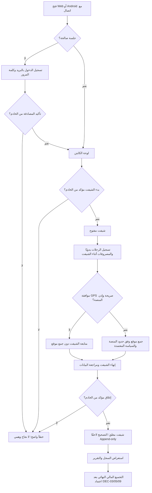
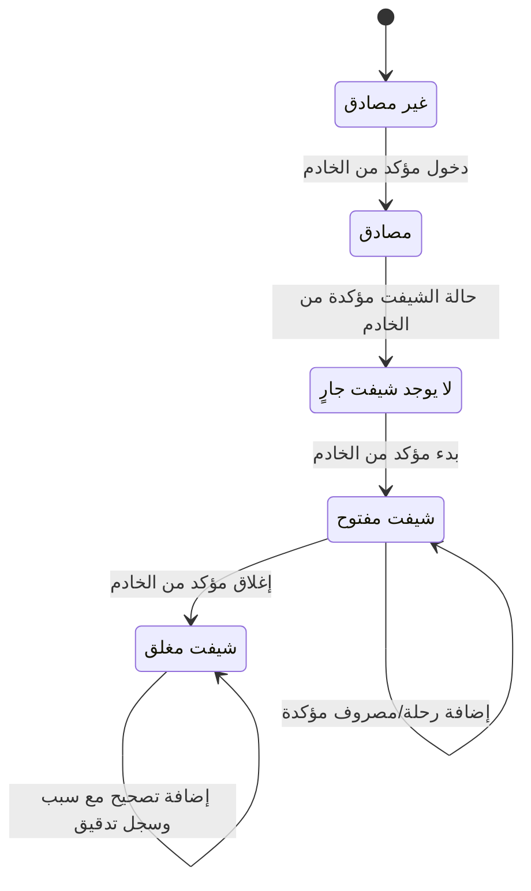

# تقرير فجوات دورة عمل Captain — FC-007

- **Issue:** [#8 — FC-007، MANUS-1](https://github.com/mosabosama2030-oss/Fleet-commander-/issues/8)
- **الحالة:** PARTIAL — تحليل وتوثيق؛ هذا التقرير لا يعتمد قرارات المنتج ولا يغلق A0.
- **المالك المنطقي:** MANUS-1 — Product Workflow Engineer.
- **Base:** `main` عند `ee2a019c1eb604933d984ff9aee03c4f898fbcd6`.
- **تاريخ خط الأساس:** 2026-11-14.
- **مصدر الجلسة 05:** `session/05-tech-auth-gps` عند `fd0805a579daad06922fe654173bdc30159d6b4f`؛ غير مدمج في `main` عند بدء المهمة.
- **قيد مهم:** PR #1 (`docs/a0-captain-requirements`) ظلّ OPEN/DRAFT عند الفحص، ورأسه `a727c8a591a312b0e856d297e7c1bc50fa5b140a`. محتواه اقتراح/متطلب غير مدمج، فلا يعامل هذا التقرير أي تفصيل فيه كاعتماد بشري ما لم يثبت في القرارات الأحدث أو تعليمات المشروع.

## 1. الغرض والنطاق

يوثق التقرير رحلة الكابتن الفردي من المصادقة حتى بدء الشيفت، تسجيل الرحلات يدويًا والمصروفات، الإغلاق، التصحيح بعد الإغلاق، والتقارير. كما يحدد الاستثناءات ومتطلبات التكاملات الخارجية وسيناريوهات القبول، ويجمع فقط القرارات والحقول التي ما زالت تحتاج حسمًا.

هذا **تحليل متطلبات** وليس عقد API أو تصميم قاعدة بيانات أو موافقة على تنفيذ. لا يختار مزودًا أو إطارًا أو سياسة مالية، ولا يغيّر أي API Contract.

## 2. قواعد الأدلة والحالة

- **VERIFIED:** قرار صريح موثق من Human Director أو في التكليف الحالي.
- **INFERRED:** نتيجة تقنية/تشغيلية مستنبطة من مصدر أو حد منصة، وليست قرار منتج معتمدًا.
- **PROPOSED:** سلوك أو حقل مرشح للنقاش، لا يُنفذ كحقيقة قبل الاعتماد.
- **UNKNOWN:** لا يوجد قرار كافٍ في الأدلة التي تمت مراجعتها.
- **PARTIAL / NOT_RUN:** حالة هذا المخرج أو التحقق، وليست ادعاءً باكتمال A0.

## 3. قرارات النطاق المعتمدة التي يجب عدم إعادة فتحها

| الموضوع | الحالة | أثره في الرحلة |
|---|---|---|
| المستخدم الأول Captain فردي، وليس سوقًا لمطابقة السائقين والركاب أو إدارة أسطول | VERIFIED | البيانات والتقارير تخص الكابتن نفسه؛ لا أدوار أسطول ضمن هذا النطاق. |
| المنصات Web + Android | VERIFIED | المطلوب تغطية المنصتين؛ النهج المسجل PWA أولًا وAndroid كتغليف لاحقًا لا يحسم التقنية النهائية. |
| الاتصال Online-only، لا Offline mode ولا طابور مزامنة مؤجل | VERIFIED | لا تُعرض كتابة محلية على أنها محفوظة خادميًا، ولا تُرسل عملية مؤجلة تلقائيًا بعد عودة الشبكة. |
| مركبة واحدة للكابتن | VERIFIED وفق قرار DEC-01 الأحدث في تقرير الجلسة 05 | لا نطلب قرارًا جديدًا عن عدد المركبات؛ تفاصيل التسجيل/التحقق من المركبة خارج هذا التقرير ما لم تؤثر على بدء الشيفت. |
| الإيراد يُسجل يدويًا، رحلةً برحلة | VERIFIED وفق DEC-02 الأحدث | لا استيراد تلقائي من تطبيقات النقل. الحقول الإلزامية والقواعد المالية ليست محسومة. |
| الشيفت ينسب إلى يوم البدء بتوقيت القاهرة؛ لا فرق أجر/سعر بين الليل والنهار | VERIFIED وفق DEC-04 المكتمل | لا نطلب تعريف ساعات الليل. ما زال يلزم حسم عرض حدود الفترات في التقرير إذا كان ذلك يتطلب تفصيلًا إضافيًا. |
| تصحيح ما بعد الإغلاق Append-only مع سبب وسجل تدقيق؛ لا حذف ولا إعادة فتح | VERIFIED وفق DEC-06 | التصحيح حدث إضافي موثق، وليس تعديلًا صامتًا لسجل مغلق. شكل التصحيح وحقوله التفصيلية غير محددة هنا. |
| الدخول بالبريد وكلمة المرور، والاستعادة عبر البريد | VERIFIED وفق DEC-07 | لا يُعاد سؤال Human Director عن طريقة الدخول؛ مزود البريد وتدفق الرسائل لم يُختارا. |
| PWA/Web متجاوب أولًا وAndroid لاحقًا كتغليف | VERIFIED جزئيًا وفق DEC-08 | التسلسل التقني محدد جزئيًا فقط؛ الاستضافة وقاعدة البيانات وإطار الخادم ما زالت مفتوحة. |
| GPS خلال الشيفت يتطلب موافقة صريحة | VERIFIED جزئيًا وفق DEC-10 | لا يبدأ جمع الموقع قبل الموافقة. الاحتفاظ وفترة العينات وما يحدث للبيانات بعد سحب الموافقة ما زالت مفتوحة. |

### قيود يجب عدم تحويلها إلى قرارات أوسع

- قيد الخلفية: تقرير الجلسة 05 يصف أن PWA لا يضمن استمرار إرسال الموقع والشاشة مقفلة/التطبيق بالخلفية، وأن التتبع الموثوق بالخلفية يحتاج تغليف Android. تصنيف هذا القيد **INFERRED** في المصدر، وليس ضمانًا تقنيًا اختُبر في هذه المهمة.
- وجود مركبة واحدة لا يحسم وحده سياسة الشيفتات المتزامنة أو منع أكثر من شيفت مفتوح؛ هذه القاعدة **UNKNOWN**.
- تسجيل الدخل رحلةً برحلة لا يحسم تعريف «الدخل»، العملة، التقريب، قواعد الصافي أو مصدر التحقق من القيمة.
- ذكر حقل مرشح أو سيناريو في المسودة لا يجعله إلزاميًا.

## 4. خريطة الرحلة الأساسية



**ملاحظات:** الرسم يصف رحلة مستهدفة، وليس تنفيذًا قائمًا. التحقق من الخادم، معالجة الأخطاء وعدم عرض نجاح وهمي متطلبات مقترحة/مدعومة بمبادئ A0؛ تفاصيل API وآلية إعادة المحاولة لم تعتمد. مسار GPS لا يعني تشغيله افتراضيًا أو تتبعه بالخلفية.

## 5. حالات الاستخدام والعمليات: المدخلات والمخرجات

تصف المدخلات أدناه الحد الأدنى المفاهيمي المطلوب لدراسة العملية. عبارة **مرشح/غير محسوم** تعني أنها ليست قائمة حقول نهائية ولا يجوز اعتبارها عقد واجهة.

| العملية | المدخلات المعروفة أو المرشحة | المخرجات المتوقعة | الحالة والضوابط |
|---|---|---|---|
| **AUTH-01 تسجيل الدخول** | VERIFIED: البريد وكلمة المرور. التحقق من الجلسة/الحساب يجري على الخادم. | عند النجاح: حالة جلسة صالحة ثم بيانات الكابتن المصرح بها؛ عند الفشل: رسالة عامة آمنة وإمكانية إعادة المحاولة. | نمط المصادقة VERIFIED؛ سياسة انتهاء الجلسة ومعدل المحاولات وتفاصيل الرسائل UNKNOWN. لا تكشف رسالة الفشل إن كان البريد مسجلًا. |
| **AUTH-02 استعادة الوصول** | البريد الذي يدخله الكابتن؛ بقية التحقق يحدده مزود المصادقة. | إرسال/بدء استعادة عبر البريد، ثم نتيجة آمنة لا تكشف حالة الحساب. | استعادة عبر البريد VERIFIED؛ المزود، صلاحية رابط/رمز الاستعادة، حدود الإرسال، وتدفق إعادة تعيين كلمة المرور UNKNOWN. |
| **SHIFT-01 بدء شيفت** | طلب بدء من الكابتن المصادق عليه. قراءة عداد البداية/صورتها حقول مرشحة في الوثائق؛ إلزاميتها غير معتمدة. المركبة واحدة وفق القرار الأحدث، فلا يعاد سؤال عدد المركبات. | معرف وحالة شيفت بعد تأكيد الخادم؛ إظهار وقت البداية وفق مصدر وقت معتمد. | الحقول الإلزامية، مصدر الوقت النهائي، شرط اتصال فعّال، منع الشيفت المتداخل، التحقق من قراءة العداد، وإلزامية الصورة UNKNOWN. لا يُعرض بدء ناجح قبل تأكيد الحفظ. |
| **TRIP-01 تسجيل رحلة/دخل** | إدخال يدوي لكل رحلة VERIFIED. المبلغ، وقت الوقوع، مصدر الرحلة/اسم التطبيق، النوع، والملاحظات حقول مرشحة، وليست كلها معتمدة. العملة والتقريب مفتوحان. | سجل رحلة مرتبط بالشيفت بعد تأكيد الخادم، وإظهار القيم التي أدخلها الكابتن دون ادعاء صافي نهائي. | DEC-03/09 يحكمان الحساب النهائي؛ مصدر المنصة وحقول كل رحلة والتحقق من القيم UNKNOWN. لا تكامل آلي مع تطبيقات النقل في MVP وفق A0. |
| **EXP-01 تسجيل مصروف** | المبلغ والتصنيف والتاريخ/وقت الوقوع مرشحة بحسب نموذج A0؛ الملاحظة أو الإيصال مرشح اختياري غير معتمد. | سجل مصروف مرتبط بالشيفت بعد تأكيد الخادم، مع إبقاء القيمة المدخلة قابلة للتتبع. | قائمة التصنيفات، السماح بالصفر/السالب، العملة، الإيصال الإلزامي، تعديل المصروف قبل الإغلاق وبعده، وسياسة الدليل UNKNOWN. لا يخترع التقرير قائمة تصنيفات. |
| **GPS-01 بدء/إيقاف جمع الموقع** | اختيار صريح من الكابتن وموافقة صريحة؛ إذن الموقع من المنصة/الجهاز. فترة العينات والدقة المطلوبة غير محسومتين. | حالة موافقة واضحة؛ عند التفعيل، نقاط موقع مرتبطة بالشيفت حسب سياسة معتمدة؛ وعند غياب الموافقة لا يبدأ الجمع. | جمع GPS بموافقة أثناء الشيفت VERIFIED جزئيًا. مصدر الدقة/الفترة/التخزين غير محدد. عند سحب الموافقة يجب إيقاف الجمع الجديد اتساقًا مع شرط الموافقة (متطلب أمان مقترح)، أما حذف السابق/الاحتفاظ به UNKNOWN ويتطلب قرارًا. |
| **SHIFT-02 إنهاء الشيفت** | طلب الإنهاء؛ قراءة عداد النهاية/المصروفات أو الرحلات الناقصة مرشحة. لا تفترض إلزاميتها قبل قرار الحقول. | نتيجة الإغلاق المؤكدة من الخادم؛ مراجعة سجل المدخلات وإظهار إجماليات خام قابلة للتفسير. | لا تعرض صافيًا أو «مستحقًا» محسوبًا كحقيقة قبل قواعد DEC-03/05/09. قواعد القراءة الأقل من البداية، الشيفت المفتوح/المتداخل، والتوقيت النهائي تحتاج تحديدًا. |
| **CORR-01 تصحيح بعد الإغلاق** | قيمة/واقعة التصحيح وسبب مفهوم؛ actor هو الكابتن المصادق عليه. | حدث تصحيح إضافي، مرتبط بالسجل الأصلي، قابل للمراجعة في التدقيق؛ لا يمحو القيمة السابقة. | Append-only مع سبب وسجل تدقيق، لا حذف ولا إعادة فتح VERIFIED. أنواع التصحيح، الموافقة الإضافية إن وجدت، وكيفية إعادة حساب التقارير UNKNOWN. |
| **REPORT-01 مراجعة تقرير** | بداية/نهاية فترة أو اختيار فترة جاهزة مرشح؛ المنطقة الزمنية المرجعية للقسمة اليومية القاهرة ويوم الشيفت هو يوم البدء VERIFIED. | سجلات الكابتن للفترة ومصدر كل قيمة؛ إجماليات غير مالية أو إجماليات خام واضحة. صافي موحد فقط بعد حسم القواعد. | خصوصية البيانات الفردية VERIFIED من نطاق المنتج؛ عملة التقرير، فترات الحواف، مقاييس التقرير، تصديره، وسياسة التصحيح في التقرير UNKNOWN. |

## 6. نموذج الحالات المقترح للرحلة

النموذج التالي **PROPOSED للتواصل والاختبار**، ولا يعتمد قواعد انتقال إضافية:



**UNKNOWN:** هل يسمح بأكثر من شيفت مفتوح، وهل للاستراحة حالة مستقلة، وما سلوك الشيفت المنسي/الطويل. لا يجوز فرض `PAUSED` أو إغلاق تلقائي أو حد زمني من هذا الرسم.

للاتصال، تتعايش كل حالة عمل مع حالة شبكة `ONLINE / OFFLINE / REQUEST_FAILED`؛ انقطاع الشبكة لا يحول طلبًا إلى نجاح ولا ينشئ وضع عمل offline.

## 7. حالات الخطأ والاستثناء والسلوك المطلوب دراسته

| الحالة | السلوك الآمن/المتسق مع الأدلة | ما زال يحتاج قرارًا أو اختبارًا |
|---|---|---|
| عدم وجود اتصال عند فتح التطبيق أو إرسال كتابة | إظهار حالة اتصال/فشل واضحة؛ لا تأكيد حفظ قبل إقرار الخادم؛ لا تخزين عملية تشغيلية في طابور offline. | نصوص الرسائل، حالات القراءة من cache إن وجدت، وآلية الاستعادة/retry. |
| انقطاع الاتصال بعد إرسال الطلب وقبل ظهور الرد | لا تفترض نجاحًا أو فشلًا نهائيًا للكتابة؛ اعرض نتيجة غير مؤكدة وامنع إعادة الإرسال الصامت. | تصميم idempotency/كشف التكرار، والاستعلام عن حالة العملية قبل retry. NFR-004 في A0 مقترح لا عقد منفذ. |
| استجابة رفض/تحقق من الخادم | عرض سبب قابل للتصرف دون كشف معلومات حساسة، مع الاحتفاظ بمدخلات المستخدم محليًا في الواجهة فقط إن كان ذلك آمنًا ولا يعد حفظًا تشغيليًا. | رموز الأخطاء والتفاصيل المسموح عرضها. |
| تسجيل الدخول/الاستعادة فشل | رد عام وآمن، مسار إعادة محاولة أو استعادة عبر البريد. | حدود المحاولات، التأخير، حالات الحساب الموقوف أو البريد غير المؤكد. |
| بدء شيفت ثانٍ أو تداخل أوقات | لا يقرر هذا التقرير السماح أو المنع. | قاعدة التداخل وفتح الشيفتات UNKNOWN، تحتاج قرارًا بشريًا/منتجيًا. |
| قراءة عداد سالبة منطقيًا أو غير متسقة | لا تصحيح تلقائي ولا إغلاق صامت. | حقول العداد والتحقق من الانخفاض/إعادة ضبط العداد وآلية التجاوز مع التدقيق. |
| رحلة منسية تضاف بعد وقت وقوعها | يمكن دراسة حفظ وقت الوقوع ووقت الإدخال كلٌّ على حدة؛ لا تُعتمد كقاعدة حتى يوافق المالك. | سلوك USER_JOURNEY القديم كان PROPOSED؛ مهلة الإضافة وما إذا كانت تغير التقرير تحتاج حسمًا. |
| شيفت يعبر منتصف الليل | ينسب للشهر/اليوم حسب يوم البدء بتوقيت القاهرة، دون اختلاف أجر نهار/ليل. | قواعد التقارير عبر الحدود الزمنية الدقيقة لم تعتمد إلا مبدأ النسبة إلى يوم البدء. |
| نسيان الإغلاق | لا تنفذ إغلاقًا تلقائيًا أو تختلق وقت نهاية. | تنبيه، حد زمني، وإدخال نهاية متأخر مع سجل تدقيق كلها UNKNOWN؛ المقترح القديم ليس قرارًا. |
| سحب موافقة GPS أو رفض إذن الجهاز | لا يبدأ جمع دون موافقة؛ يوقف الجمع الجديد عند سحبها/فقدان الإذن، ويشرح حالة GPS بدل الإيحاء بأنه يعمل. | مصير النقاط السابقة عند السحب، محاولة إعادة طلب الإذن، وفروق Android/Web. |
| التطبيق في الخلفية أو الشاشة مقفلة | لا تعرض «تتبعًا مستمرًا» غير مضمون؛ قيد PWA background INFERRED في تقرير الجلسة 05. | هل MVP يقبل foreground-only أم يقدم Android مبكرًا؛ قرار بشري بعد اختبار المنصات. |
| تصحيح بيانات مالية مغلقة | إضافة سجل تصحيح بسبب واضح وعدم محو الأصل. | صلاحية تعديل المكونات التفصيلية، التقارير القديمة، وآلية مراجعة الكابتن. |
| لا توجد سجلات في فترة التقرير أو فترة غير صالحة | حالة فارغة واضحة أو رفض مدخلات الفترة؛ لا تعرض صفرًا ملتبسًا على أنه بيانات مؤكدة. | قواعد بداية/نهاية الفترة والتقويم والعرض. |

## 8. متطلبات التكاملات الخارجية — دون اختيار مزود أو API

لا توجد في الأدلة عقود API نهائية لهذه التكاملات. الجدول يحدد الحدود السلوكية فقط؛ لا يجيز إضافة مزود أو اعتماد تكلفة.

| التكامل/الاعتماد | الغرض والمدخلات/المخرجات | الحالة الحالية ومتطلبات الفشل/الخصوصية |
|---|---|---|
| **المصادقة والبريد** | إدخال بريد/كلمة مرور؛ استخدام خدمة مصادقة؛ بدء استعادة الحساب عبر البريد وإبلاغ المستخدم بنتيجة آمنة. | طريقة البريد+كلمة المرور واستعادة البريد VERIFIED. مزود الهوية والبريد، إدارة الجلسة والرموز، الحدود والتكلفة UNKNOWN. لا تكشف حالة وجود البريد. |
| **إذن الموقع/خدمة تحديد الموقع** | طلب إذن صريح؛ عند الموافقة، مصدر النقاط ووقت القياس؛ ربط البيانات بالشيفت. | GPS بموافقة أثناء الشيفت VERIFIED جزئيًا. واجهات Web/Android وقدرات الخلفية INFERRED/تحتاج اختبارًا على جهاز؛ interval/retention/deletion UNKNOWN. لا جمع عند غياب الموافقة. |
| **تطبيقات النقل (مثل Uber/DiDi/inDrive)** | لا تبادل بيانات آلي في MVP؛ الكابتن يسجل كل رحلة يدويًا. | التكامل الآلي خارج نطاق A0 بحسب المتطلبات؛ لا scraping أو استخراج غير رسمي. أسماء المصادر والبيانات اليدوية لكل رحلة ما زالت غير محددة. |
| **خرائط/ETA** | قد تستقبل نقطة/وجهة لإنتاج خريطة أو ETA إذا اعتمدت الوظيفة لاحقًا. | مزود الخرائط/ETA DEC-11 مؤجل إلى D3؛ لا اختيار أو اتصال مطلوب لهذا النطاق. تجنب إرسال الموقع لمزود خارجي قبل قرار خصوصية/مزود صريح. |
| **الخادم وواجهة API وقاعدة البيانات** | حفظ مركزي، مصادقة الملكية، تأكيد الكتابات وإرجاع سجلات الكابتن. | مصدر الحقيقة الخادمي مبدأ موثق في A0؛ الخادم/الاستضافة/قاعدة البيانات مفتوحة جزئيًا في DEC-08. هذا التقرير لا يعدل عقدًا ولا يفترض endpoints. |
| **تغليف Android** | إتاحة رحلة Android؛ قد يؤثر على إذن الموقع والعمل بالخلفية. | Android مستهدف وقرار PWA-first/تغليف لاحق جزئيًا VERIFIED؛ التقنية النهائية ودعم background location غير محسومين. لا يعد هذا التقرير دعمًا منفذًا. |

## 9. سجل الفجوات التي تتطلب حسمًا — دون تكرار الإجابات

### P0 — قرارات مالية/خصوصية/تقنية

| القرار | الحقول أو الأدلة المطلوبة من MOSAAB | العمليات المتأثرة | الحالة |
|---|---|---|---|
| **DEC-03 — قواعد الأجر/التسعير** | مثالان حقيقيان منزوعا الهوية على الأقل: نوع/مدة الشيفت، الكيلومترات، الرحلات وقيمها، أي خصومات/حوافز/مصروفات، والمبلغ المستلم فعليًا؛ ثم تحديد قاعدة الحساب وأي مدخلات إضافية. لا ترسل بيانات تعريف شخصية. | إغلاق الشيفت، الملخص، التقارير، أي صافي/توصية مالية. | OPEN/BLOCKED حسب سجل القرار؛ لا معادلة مقترحة تصبح حقيقة هنا. |
| **DEC-05 — المصروفات/الخصومات/الحوافز** | قائمة التصنيفات المعتمدة؛ هل الخصم/الحافز نوع مستقل أم مصروف/دخل؛ حقول التصنيف؛ متى يجوز التعديل؛ وهل يلزم إثبات لكل نوع. | تسجيل مصروف، إغلاق، تقارير. | OPEN. |
| **DEC-09 — العملة والتقريب** | العملة، وحدة التخزين/العرض، قواعد الكسور والتقريب، وكيفية التعامل مع قيمة ناقصة أو صفر/سالبة في كل نوع سجل. | إدخال الرحلة والمصروف والإجماليات والتقارير. | OPEN. لا تفترض EGP أو قرشًا رغم ورودها كاقتراح قديم. |
| **DEC-10 — الموقع والخصوصية** | فترة أخذ العينات، مدة الاحتفاظ، طريقة الإيقاف عند سحب الموافقة، مصير النقاط الموجودة عند السحب، وسياسة الوصول/التصدير/الحذف. | موافقة GPS والجمع والتخزين والعرض. | VERIFIED جزئيًا: موافقة صريحة أثناء الشيفت. بقية التفاصيل OPEN. |
| **DEC-08 — التقنية والاستضافة** | اختيار إطار/لغة الخادم، استضافة، قاعدة بيانات، وتحديد طريقة تغليف Android وما يلزم للموقع في الخلفية. | تسجيل الدخول، الحفظ، الموقع، التكاملات. | VERIFIED جزئيًا: Web/PWA أولًا وAndroid لاحقًا كتغليف؛ التقنية الفعلية OPEN. PostgreSQL اقتراح لا قرار. |

### قرارات/حقول متصلة بالتجربة

- حقول بدء الشيفت وإنهائه وإلزامية العداد/الصورة: **UNKNOWN** (DEC-12 يضع صور العداد ضمن P1 المقترح، لا قاعدة معتمدة).
- قاعدة تعدد الشيفتات/تداخلها، الاستراحة، الشيفت المنسي/الإغلاق المتأخر: **UNKNOWN**.
- مصدر الوقت لكل حدث (الخادم أو جهاز المستخدم) وآلية تمييز وقت الوقوع من وقت الإدخال: **UNKNOWN**.
- نموذج رحلة يدوي: الحقول الإلزامية وتعريف مصدر الرحلة/القيمة وطريقة إثباتها: **UNKNOWN**؛ لا API import.
- إثبات التسوية/الدفعة DEC-13 وطريقة تأكيد المستلم: **UNKNOWN**، ولا ينبغي أن توحي التقارير بأن الإيراد المسجل تم استلامه.
- معايير التقرير، امتداد الفترات، تصدير البيانات، وسياسة الوصول الإداري: **UNKNOWN**.
- DEC-11 لمزود الخريطة/ETA مؤجل إلى D3؛ لا يلزم حسمه لإكمال تسجيل الرحلة يدويًا.

## 10. سيناريوهات القبول المقترحة

هذه سيناريوهات لاختبار المنتج **بعد** تثبيت الحقول والسياسات. السيناريو لا يحسم قرارًا ماليًا أو تقنيًا مفتوحًا.

### AC-01 — دخول ناجح

```gherkin
Given أن الكابتن لديه اتصال بالإنترنت وحساب صالح
When يدخل بريده وكلمة مروره الصحيحتين
Then لا تظهر لوحة الكابتن إلا بعد تأكيد جلسة المصادقة
And تعرض بيانات الحساب المصرح بها فقط
```

### AC-02 — فشل دخول/استعادة دون كشف الحساب

```gherkin
Given أن الكابتن يدخل بيانات لا تنتج جلسة صالحة
When يرفض الخادم الطلب أو يتعذر الاتصال
Then لا تظهر حالة دخول ناجحة
And تظهر رسالة آمنة قابلة للتصرف لا تكشف وجود البريد
And يظل مسار الاستعادة عبر البريد متاحًا وفق السياسة المعتمدة
```

### AC-03 — لا نجاح زائف عند فشل الشبكة

```gherkin
Given أن الكابتن يحاول بدء شيفت أو حفظ رحلة/مصروف أو إغلاق شيفت
When لا يمكن الوصول إلى الخادم أو لا يصل تأكيد نجاح
Then لا تعرض الواجهة السجل على أنه محفوظ خادميًا
And لا تنشئ طابور عمليات تشغيلية يرسل تلقائيًا عند عودة الاتصال
And تعرض للمستخدم الحالة التي تتيح له اتخاذ إعادة المحاولة وفق سلوك idempotency المعتمد
```

### AC-04 — رحلة إلى رحلة يدويًا

```gherkin
Given أن شيفت الكابتن مفتوح ومؤكد من الخادم
When يدخل رحلة جديدة يدويًا ويرسلها
Then لا تملأ الرحلة من تكامل غير معتمد مع تطبيق نقل
And لا تظهر الرحلة كسجل محفوظ إلا بعد تأكيد الخادم
And لا تعرض صافيًا نهائيًا قبل اعتماد DEC-03 وDEC-09
```

### AC-05 — تصنيف يوم الشيفت

```gherkin
Given أن الشيفت بدأ قبل منتصف الليل واستمر بعده بتوقيت القاهرة
When يعرض النظام اليوم التشغيلي/التقرير وفق قرار DEC-04
Then ينسب الشيفت إلى يوم بدايته
And لا يطبق فرق سعر ليلي/نهاري
```

### AC-06 — إغلاق وتصحيح Append-only

```gherkin
Given أن شيفتًا مغلقًا ومؤكدًا
When يطلب الكابتن تصحيح قيمة ويقدم سببًا
Then يضيف النظام حدث تصحيح مرتبطًا بالأصل مع أثر تدقيق
And تبقى القيمة/الواقعة الأصلية قابلة للمراجعة
And لا يسمح هذا التدفق بحذف الأصل أو إعادة فتح الشيفت
```

### AC-07 — GPS بموافقة

```gherkin
Given أن شيفتًا مفتوحًا
And لم يمنح الكابتن موافقة GPS صريحة
When يستخدم التطبيق
Then لا يبدأ جمع الموقع
When يمنح موافقة صريحة وإذن الجهاز متاحًا
Then يعرض النظام أن الموقع يعمل ضمن حدود المنصة والسياسة المعلنة
And يوقف جمعًا جديدًا إذا سحب الموافقة أو أزال إذن الموقع
```

يظل المتوقع عند السحب بشأن حذف النقاط السابقة أو الاحتفاظ بها **محجوبًا** حتى اعتماد DEC-10.

### AC-08 — تقرير ضمن الحساب والفترة

```gherkin
Given أن الكابتن المصادق عليه يختار فترة تقرير صالحة
When يطلب التقرير
Then لا يتلقى إلا سجلات حسابه
And تكون قاعدة نسبة الشيفت إلى يوم البداية بتوقيت القاهرة ظاهرة/متسقة
And تميز الواجهة القيم المسجلة عن القيم المحسوبة أو المقدرة
And لا تعرض صافيًا ماليًا نهائيًا قبل اعتماد قواعد المال
```

### AC-09 — قيد PWA عند الخلفية

```gherkin
Given أن الكابتن اختار GPS في جلسة PWA
When يصبح التطبيق بالخلفية أو الشاشة مقفلة
Then لا يدعي المنتج استمرار تتبع لم يتم التحقق منه
And يعرض حالة التتبع الفعلية بوضوح
```

هذا السيناريو قائم على قيد **INFERRED** في تقرير الجلسة 05 ويحتاج اختبارًا على المتصفحات/الأجهزة المستهدفة قبل اعتماده كقبول تنفيذي.

### AC-10 — تعارض شيفت/نسيان إغلاق

```gherkin
Given أن هناك شيفتًا مفتوحًا أو متأخر الإغلاق
When يحاول الكابتن بدء شيفت آخر أو يستأنف الجلسة
Then يعرض النظام الحالة الحالية بوضوح
And يطبق فقط قاعدة التداخل/التذكير التي يعتمدها MOSAAB
And لا ينشئ أو يغلق شيفتًا تلقائيًا بناءً على افتراض
```

## 11. المخاطر والاعتماديات

1. **المحرك المالي محجوب:** إظهار صافي أو استحقاق قبل DEC-03/05/09 خطر وظيفي؛ اعرض البيانات الخام أو صرّح بأن الحساب غير متاح حتى الاعتماد.
2. **خصوصية الموقع:** عدم حسم الاحتفاظ/الفترة/السحب يمنع تثبيت تفاصيل جمع GPS وتخزينه. لا تضف مزود خرائط أو مشاركة موقع.
3. **حدود الخلفية:** PWA لا يضمن التتبع في الخلفية بحسب استنتاج تقرير الجلسة 05؛ يلزم اختبار المنصة واختيار تقني بشري قبل ادعاء التتبع الكامل.
4. **الفشل الشبكي والتكرار:** Online-only لا يعني أن استجابة العملية تصل دائمًا؛ إعادة المحاولة تحتاج منعًا معتمدًا للتكرار، دون false success.
5. **مصادر غير مدمجة:** وثائق الجلسة 05 وPR #1 ليست جزءًا من `main` عند خط الأساس. هذا التقرير يذكر مصدر كل قرار ولا يطلب دمجًا أو يعتمد المشروع كله.
6. **غياب اختبار منتج:** لم تُشغّل واجهة أو API أو اختبارات تكامل؛ كل acceptance scenarios هنا خطة مستقبلية.

## 12. المراجع التي تمت مراجعتها

- [Issue #8 — FC-007](https://github.com/mosabosama2030-oss/Fleet-commander-/issues/8)؛ مفتوحة، غير مسندة في قائمة assignees، ولا CLAIM سابق عند بدء المهمة.
- `main` عند `ee2a019c1eb604933d984ff9aee03c4f898fbcd6`؛ يشمل تعليمات `AGENTS.md`, `MANUS.md`, نموذج الفريق وفهرس المهام بعد دمج PR #12.
- `session/05-tech-auth-gps` عند `fd0805a579daad06922fe654173bdc30159d6b4f`، وخاصة:
  - `docs/sessions/SESSION_05_REPORT_AR.md`
  - `docs/a0/OPEN_DECISION_REGISTER_AR.md`
  - `docs/a0/USER_JOURNEY_AR.md`
  - `A0_REQUIREMENTS_AR.md`
- [PR #1](https://github.com/mosabosama2030-oss/Fleet-commander-/pull/1) — OPEN/DRAFT وغير مدمج عند المراجعة؛ لم يجرِ تعديل محتواه.
- [PR #12](https://github.com/mosabosama2030-oss/Fleet-commander-/pull/12) — MERGED عند المراجعة، لذلك بدأ فرع FC-007 من `main` الحالي لا من فرع التعليمات السابق.

## 13. التحقق وحدود الإنجاز

- **حالة التنفيذ:** PARTIAL — التقرير وثيقة تحليلية، وليس تنفيذًا وظيفيًا أو اعتمادًا لـA0.
- **اختبارات المنتج:** NOT_RUN — لا يوجد كود منتج في هذا التغيير.
- **التحقق الفعلي للمستند:** `git diff --check` نجح بلا أخطاء whitespace؛ فحص اكتمال الملف وتوازن أسوار الكود ووجود السيناريوهات AC-01..AC-10 والقرارات DEC-03/05/08/09/10/11 نجح. صُيّر مخططا Mermaid بنجاح ثم روجعا بصريًا؛ واستجابت روابط GitHub الثلاثة برمز HTTP 200 وقت الفحص. لم يُشغّل markdown linter أو اختبارات منتج.
- **ما لم يُنجز:** لا اعتماد بشري للقرارات المفتوحة، لا تعديل API/كود، لا اختبار جهاز أو GPS أو شبكة، ولا دمج أو نشر.
- **المالك التالي للقرارات:** MOSAAB لحسم DEC-03/05/09/10 وتفاصيل التقنية؛ ثم CHATGPT-1 لتحديث الـbacklog وفق Issue #8 بعد المراجعة البشرية.
